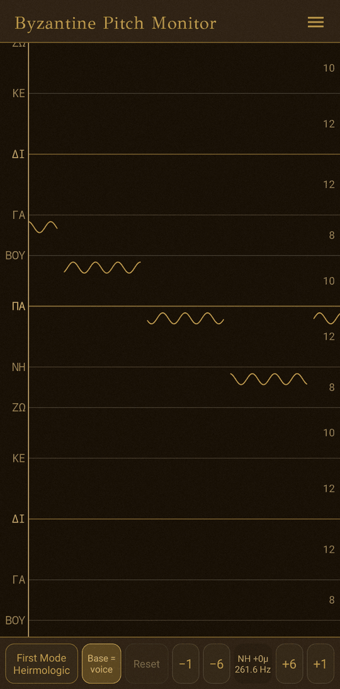
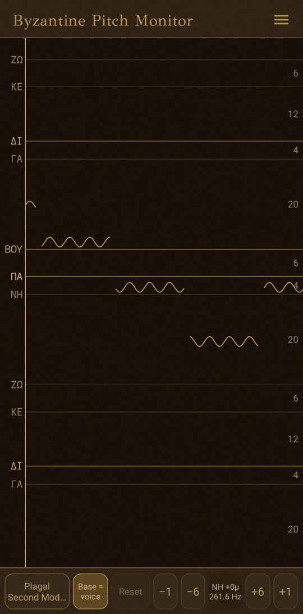
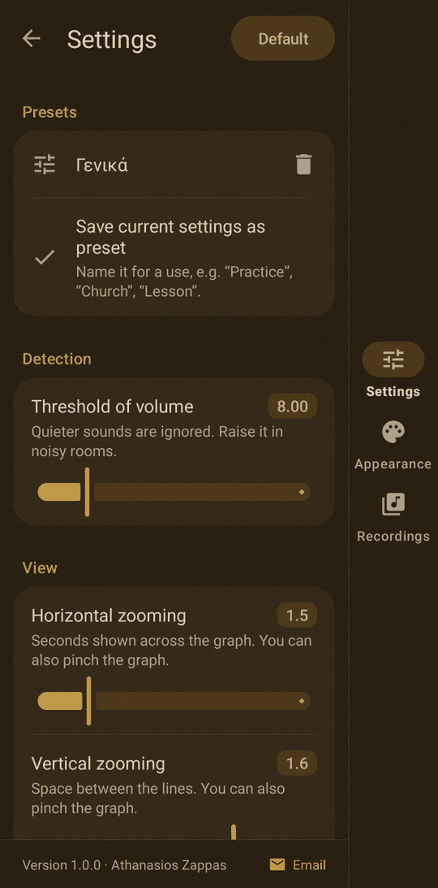
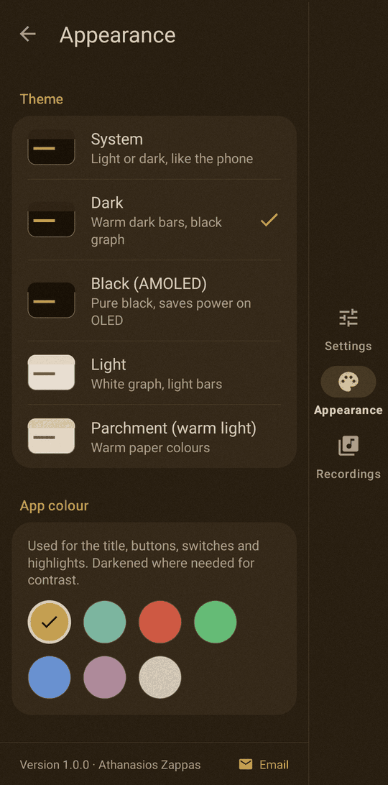

<div align="center">


# Byzantine Pitch Monitor

**See your chanting.** A real-time pitch monitor for Byzantine chant and European scales on Android.

Sing or play, and your voice is drawn over the lines of the chosen ήχος
(72-moria Chrysanthine system) or European scale.


[Features](#features) · [Build](#build) · [Project layout](#project-layout) · [Debug options](#debug-launch-options) · [Credits](#credits)

<br>

<table>
  <tr>
    <td align="center"><br><sub>First Mode, heirmologic</sub></td>
    <td align="center"><br><sub>Plagal Second, hard chromatic</sub></td>
    <td align="center"><br><sub>Settings and presets</sub></td>
    <td align="center"><br><sub>Themes and app colour</sub></td>
  </tr>
</table>

</div>

---

## Features

**Byzantine chant**
- All eight ήχοι plus Βαρύς Διατονικός and Πλ.Δ' εκ του Γα, with their genera in moria.
- Base (βάση) line in its own colour; dominant notes (δεσπόζοντες) optionally highlighted.
- Melody genre in the scale picker: Ειρμολογικό, Στιχηραρικό, Παπαδικό, wherever a source gives different bases or dominants.
- Moria steps between the lines, so the genus is visible at a glance.
- Move Νη by ±1 or ±6 moria, or sing the base and tap **Base = voice** to tune to your voice.
- Byzantine tempo presets (αγωγή) alongside a free BPM slider, with beat lines.

**European scales**
- Major/minor scales and Chromatic, note names (C D E… or Do Re Mi…), octave numbers.
- Transposing instruments (B♭, E♭, F), transpose slider, A4 calibration 415–465 Hz.

**Monitoring**
- Live pitch line with a tuner: nearest note, ±110-cent ruler, frequency in Hz.
- Auto scroll, pinch zoom, **HOLD** to freeze and scroll back.
- Record, play back, import any audio file, and send or rename recordings.

**Make it yours**
- Themes: System, Dark, Black (AMOLED), Light, Parchment. Every colour pair meets WCAG AA contrast.
- App colour, graph colour schemes and a colour picker for every line.
- Settings presets: save and load whole setups by name.
- English or Greek, independent of the phone's language.
- No ads, no analytics. Audio stays on the phone.

## Build

Requirements: JDK 17 and the Android SDK (platform 37). The Gradle wrapper is included.

```bash
./gradlew assembleDebug        # app/build/outputs/apk/debug/app-debug.apk
./gradlew testDebugUnitTest    # unit tests (scales, spelling, Base = voice, pitch detector)
./gradlew assembleRelease      # signed with the debug key until you add your own
```

The debug build installs as `app.pitchmonitor.byz.dev` ("Byzantine Pitch Monitor (dev)") so it
can sit next to the 1.6.0 app; the release build uses `app.pitchmonitor.byz`, version 1.0.0 (1).

This project is written from scratch. It reproduces the screens and behaviour of the
"Byzantine Pitch Monitor 1.6.0" APK as a starting point; no code from that APK is used.
[NOTES.md](NOTES.md) records every design choice, the sources for each mode's base and
dominants, and what has been verified on a device.

## Project layout

| Part | File |
| --- | --- |
| Byzantine modes, genera, European scales, note names, scale list | `app/src/main/java/app/pitchmonitor/byz/Music.kt` |
| Settings and their defaults | `Prefs.kt` |
| Pitch detector (YIN), microphone, WAV files, import, playback | `Audio.kt` |
| The pitch graph, tuner, beat lines, gestures | `PitchView.kt` |
| Main screen: bars, base controls, HOLD, record / play / stop | `MainActivity.kt`, `res/layout/activity_main.xml` |
| Settings, Appearance and Recordings with the right navigation rail | `HubActivity.kt` |
| Card/switch/slider building blocks | `Ui.kt` |
| Colour roles, contrast checks, themes, language | `Theme.kt` |
| Colour picker | `ColorPicker.kt` |

## Debug launch options

MIUI phones block simulated taps over adb, so debug builds accept these extras:

```bash
adb shell am start -n app.pitchmonitor.byz.dev/app.pitchmonitor.byz.MainActivity --ez demo true --ei scaleIndex 1
adb shell am start -n app.pitchmonitor.byz.dev/app.pitchmonitor.byz.MainActivity --es open settings --ei scrollTo 900
```

- `demo` feeds a synthetic voice instead of the microphone.
- `scale` picks a scale by name, `scaleIndex` by its place in the list (0 = C Major, 1 = Ήχος Α').
- `open settings|appearance|recordings|menu` opens that screen (`selectAll` selects every recording); `scrollTo` scrolls Settings down (dp); `picker` opens the colour picker.
- `theme light|dark|black|parchment|system`, `lang en|el`, `accent 0..6` change the look. These are saved like the user's own choices.
- `importFile <path>` imports an audio file the app can read.

## Credits

The title uses GFS Didot by the Greek Font Society, under the SIL Open Font License
(`app/src/main/assets/fonts/GFSDidot-OFL.txt`). The lyre launcher icon is the owner's own.
